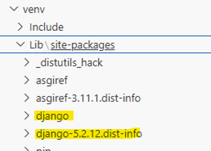
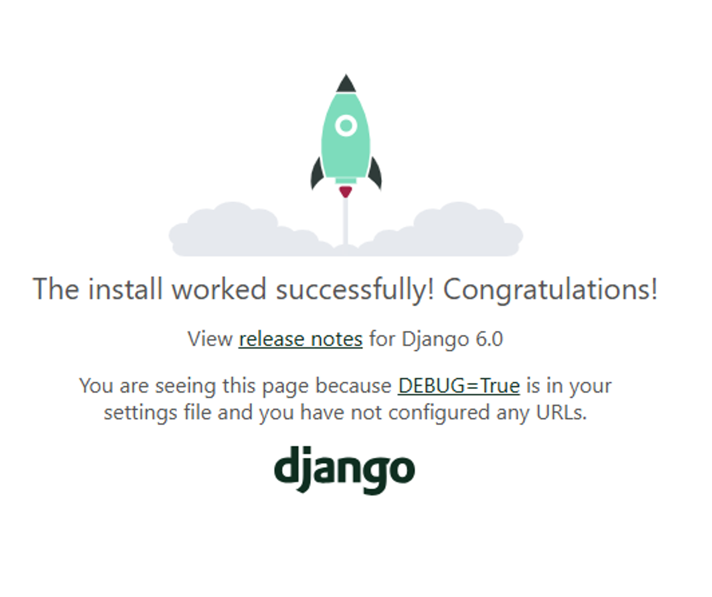
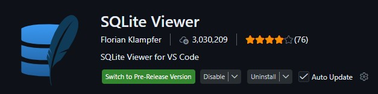
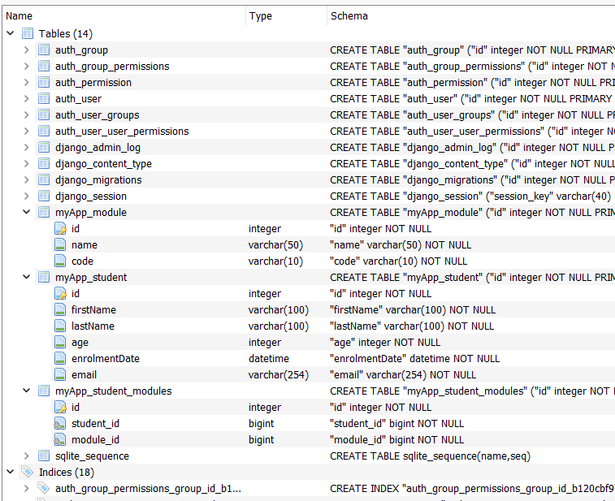
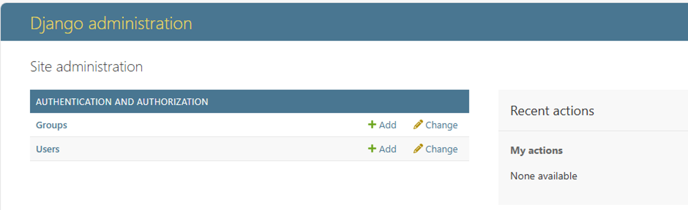
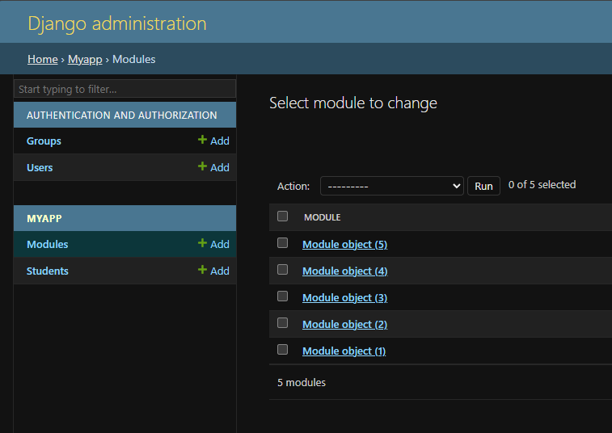

# Week 03 - Introduction to Django

This week we will create a simple django project with a single app. 

## Creating a Virtual Environment

The issue with python's extensibility is that it can become difficult to manage exactly which packages you need for a particular project or application. With this in mind we will create a virtual environment which is a clean python environment and then install any packages/libraries we need to this environment.

```bash
python -m venv venv
```
This will create a virtual environment called ```venv``` - we can use whatever name we wish here but this is a commonly used name and is by default included in the python .gitignore file which means it will not become part of our repo. Once you have run this you should see that a new folder has been created call ```venv``` with a number of subdirectories and files - this is our python environment we will be using.

We now need to *use* or *activate* this environment:

```bash
# On windows based machines
./venv/Scripts/activate.bat
```

```bash
# On linux based machines
source ./venv/bin/activate
```

Once complete you should see the name of the virtual environment in parentheses at the start of the command prompt:

```bash
(venv) @nigel-edwards ➜ /workspaces/WebProgramming (main) $ 
```

or 

```bash
(venv) PS C:\Users\ne18\OneDrive ...
```

## Installing Django

Installing Django is a simple as adding the package to your enviroment:

```bash
python -m pip install django
```

This will add a series of files and folders into your ```venv``` 



You can test the install by running:

```bash
python –m django --version
```

Remember because the ```venv``` directory is included within the ```.gitignore``` file none of the installed packages will be saved to your GitHub repository. As such in order to be able to recreate the environment you should use the ```pip freeze``` functionality to keep a list of all your installed packages.

```bash
python -m pip freeze > requirements.txt
```

This will create a file called ```requirements.txt``` with a list of all your packages and to restore them you can just use:

```bash
python -m pip install -r requirements.txt
```

### Create a new project

Now that Django is installed we can create a new project:

```bash
django-admin startproject <projectname>
```

This will create a new folder called ```<projectname>``` with the following files within it:

- manage.py - scripts used to manage the project
- projectname/init.py - dunder init
- projectname/asgi.py - hooks for web servers such as apache
- projectname/settings.py - configures Django
- projectname/urls.py - routes requests based on URL
- projectname/wsgi.py - hooks for web servers such as apache

### Running the project

We can now run this project.  Simply navigate to the newly created project directory - this should contain the ```manage.py``` file.  Then start the server:

```bash
python manage.py runserver
```

You should see the server running at it's portnumber :

- "Starting development server at http://127.0.0.1:8000/"

Opening this in a web browser will show the welcome page:



You should also note the creation of the SQLite database file ```db.sqlite3```

## Creating a Django App

Remember in Django an app is:

- A component within a Django project.
- A folder within the project containing python, html, and data files.
- Each app should fulfil a single purpose.

```bash
python manage.py startapp <appname>
```

This will create a folder called <appname> at the same levelt as the <projectname> directory. The files created for you are:

- admin.py - admin to see and edit data for this app
- apps.py - settings for this app
- models.py - data layer for this app
- tests.py - used to write unit tests for this app
- urls.py - routing for app
- views.py - logic to handle requests and define HTTP responses
- migrations/ - data files for changing db schema

Once created we need to add the app to the project, this requires us to edit the file ```projectname/settings.py``` and add a line to the ```INSTALLED_APPS``` section.  In this example we have used the app name of *myApp*

```python
INSTALLED_APPS = [
    "django.contrib.admin",
    "django.contrib.auth",
    "django.contrib.contenttypes",
    "django.contrib.sessions",
    "django.contrib.messages",
    "django.contrib.staticfiles",
    "django_extensions",
    "myApp",
]
```

### Models

For this example we use an example University web site which lists a series of Students and the Modules that they been enroled on.

So for models we are going to require both a student and module class and then we will need to create a relationship between them.

To do this we will need to edit the ```appName/models.py``` file

#### The Student class

```python
from django.db import models

class Student(models.Model):
    firstName = models.CharField(max_length=100)
    lastName = models.CharField(max_length=100)    
    age = models.IntegerField()
    email = models.EmailField(blank = True)
    enrolmentDate = models.DateTimeField()
```

A full list of possible field types and examples of their uses can be found in the [Django Documentation](https://docs.djangoproject.com/en/6.0/ref/models/fields/).

#### The Module Class

```python
class Module(models.Model):
    code = models.CharField(max_length=10)
    name = models.CharField(max_length=50)
```

#### Relationship between the Classes

A detailed list of possible relationships between classes can be found in the [Django Documentation](https://docs.djangoproject.com/en/6.0/ref/models/fields/#module-django.db.models.fields.related).  But for this example we will use a simple many to many relationship - so many Students can be enrolled on many modules. To do this we will add an additional field to the ```Student``` class:

```python
modules = models.ManyToManyField('Module', blank = True)
```


Note full models.py file is provide on Canvas and [here](./code/models.py)

#### Migrations

Migrations are scripts used to modify the database when things have changed such as - adding a model or adding, removing or changing a field.

- ```python manage.py makemigrations``` - Looks at models and generate scripts to handle changes. Creates numbered files, starting from 1, in the appname/migrations directory.
- ```python manage.py showmigrations``` - Lists all migrations index [ ] = not run; [X] = has been run
- ```python manage.py migrate``` - Runs all the migrations that have not been run. Or we can run to a specific migration number on a specific app.

So we now need to make the migrations and then run them. Note when the migrations run the file db.sqlite3 file will be updated. This file is excluded by default in the .gitignore file if you want to back this up, comment the line out.

To view the database either:
 - install the [SQLLite Browser](https://sqlitebrowser.org/)
- Or add the visual studio code extension “SQLite Viewer”



Example Database



### Adding Data from a CSV

Django provides functionality in order to manualy run user created scripts for general maintenance. Full details of the methodology can be found in the [Django Documnentation](https://django-extensions.readthedocs.io/en/latest/runscript.html). Very basically this can be distilled to:

1. First you must install django-extensions:
   - ```python –m pip install django-extensions```
2. Create a scripts directory under your project directory
3. Add a blank dunder init file into this new scripts directory  ```__init__.py```
4. Place the script into this directory. The script must have a run function as this is what will be executed
5. Then we can execute the script:
    - ```python manage.py runscript <script name>```

The example script and data can be either found on Canvas or here [script](./code/load_students.py) and [csv](./data/students.csv).

The script simply reads a csv file line by line, for each new line a student object is created using the column data and then saved to the data base. The module names use a simple hard coded list of codes and names.

```python
modules = {
    "MOD002619": "Web Programming",
    ...
}

def run():
    ...
    print("Creating module data")
    for mcode, mname in modules.items():
        mod = Module(code=mcode, name = mname)
        mod.save()

    print("Loading student data")
    for row in DictReader(open('./students.csv')):
        stu = Student()
        stu.firstname = row['fname']
        stu.lastname = row['lname']
        ...
        stu.save()

        # Now add the module enrolments
        raw_modules = row['modules']
        module_names = [name for name in raw_modules.split('| ') if name]
        for mod_name in module_names:
            mod = Module.objects.get(code=mod_name.strip())
            stu.modules.add(mod)
        stu.save()
```

## The Django Admin App

When you ran the migrations, you would have seen an admin app, this is an inbuilt Django App

- Can be used to manually add and edit data into DB
- Needs a password:
  - ```python manage.py createsuperuser```
  - Fill out details, note password is not echoed to the screen.

To access the admin app assuming your server is still running just append /admin to the path:
http://127.0.0.1:8000/admin/

Note if running in code spaces the port will be mapped differently e.g.:
https://stunning-space-trout-4qqxrqw4v9hxqx-8000.app.github.dev/admin/

Then simply login using the credentials you set using the ```createsuperuser``` at the moment we cannot see the Pet or Vaccine tables



We must must register our models with the Admin app to view them - Edit the file ```<appname>/admin.py```

```python
from django.contrib import admin

from .models import Student
from .models import Module

admin.site.register(Student)
admin.site.register(Module)
```



## ToDo

Create a simple project to view a series of Rugby teams:

- Rugby Players can often play more than one position
- Some positions are very specialist and only those allocated to those positions can play them for safety reasons.
- Create a new site with a new app which models players and positions with a many to many relationship
- Ensure that you can view the player data in your Admin site
- See if you can create a csv of data and modify the scripts given to import that data. 

Rugby positions:

- **Tight Head Prop**
- **Hooker**
- **Loose Head Prop**
- Second Row**
- Open Side Flanker
- Blind Side Flanker
- Number 8
- Scrum Half
- Fly Half
- Inside Centre
- Outside Centre
- Left Wing
- Right Wing
- Full Back

**Bold** are specialist positions

[back](../README.md)