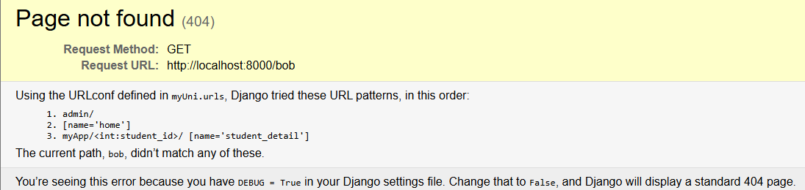
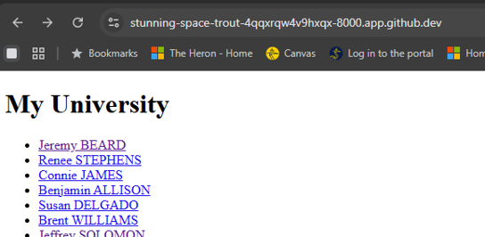
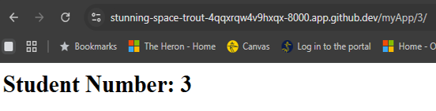
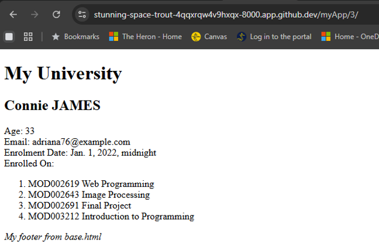

# Week 04 Django Template and Object Relational Mapping (ORM)

## Object Relational Mapping (ORM)

Along with other common web frameworks Django uses Object Relational Mapping (ORM) to query and manipulate data. The ORM gives a direct mapping from Python classes and objects to database tables and tuples. The ORM enables the same Python code to be used to access many different database - we will look at how to modify the setting to use a postgres database latter. For full information on how to use the ORM API please refer to the [Django Documentation](https://docs.djangoproject.com/en/6.0/topics/db/queries/).

We will use ORM queries to populate the data onto our web pages. We can test these ORM queries directly by using a python shell which can be started with the ```manage.py``` script:

```python
python manage.py shell
```

### Simple ORM Query

From within the shell:

```python
# Import our `Student` model
from myApp.models import Student

# Query the database and return all the students as a result set
students = Student.objects.all()

# We can now access a single Student as if from an array.
student = students[0]

#And then access the attributes of that object
print( student.firstName )
```

### Other Simple Queries

```python
# Access a single object by id
student = Student.objects.get( id=2 )

# Will throw an error if no object meets the criteria
# pUniapp.models.Student.DoesNotExist: Student matching query does not exist.

# Can use other attributes but again these can throw errors
student = Student.objects.get( age=18 )

# myApp.models.Student.MultipleObjectsReturned: get() returned more than one Pet -- it returned more than 20!
```

### Handling non unique returns

```python
# Use the filter method which returns a ResultSet
student = Student.objects.filter(age=18)

print(student)
# <QuerySet [<Student: Student object (24)>, < Student : Student object (38)>, < Student : Student object …

print(student[1].firstName)
#Joshua
```

### Handling Relationships

```python
student = Student.objects.get( id=7 )

# Note use of the all here so we have an iterable result set
modules = student.modules.all()

print( modules )
# <QuerySet [<Module: Module object (3)>, < Module : Module object (4)>]>

print( modules[1].name )
# Introduction to Programming

# Or iterate over them
for module in modules:
    print( f"{module.code.upper()} {module.name.capitalize()}" )

# MOD002691 Final project
# MOD003212 Introduction to programming
```

## URL Path Handling

URL's are defined on an App by App basis in a Python modules called ```URLconf```. This uses definitions in Python that maps between URLs and views. We currently have two apps ```admin``` and ```myApp```. Our current ```project.urls.py``` file just maps to the admin app:

```python
from django.contrib import admin
from django.urls import path

urlpatterns = [
    path("admin/", admin.site.urls),
]
```

We need to modify this file so that a new ```urls.py``` in our new app is included. This requires us to import 'include' from djongo.urls and then include this new file mapped as to a default empty path:

```python
from django.contrib import admin
from django.urls import include, path

urlpatterns = [
    path("", include("myApp.urls")),
    path("admin/", admin.site.urls),
]
```

We then can create the new file ```myApp.urls.py```:

```python
from django.contrib import admin
from django.urls import path

from . import views

urlpatterns = [
    path('', views.home, name="home"),
    path('myApp/<int:student_id>/', views.student_detail, name='student_detail'),
]
```

URL patterns are checked in order top to bottom. The include myApp.urls in the project urls.py means that the paths within that file are analysed first. If a pattern is matched, the function is called, so if there is nothing appended to the site's URL the function ```myApp.views.home``` is called. In the angle brackets we are using an Integer type so will match with any integer here - the value here is then assigned to the variable student_id in our view function. This means that if we append ```myApp/2``` to the site's URL the function ```myApp.views.student_detail``` will be called with a passed parameter ```student_detail``` which has a value of **2**. Other converter types can be found in the [Django documentation](https://docs.djangoproject.com/en/6.0/topics/http/urls/#path-converters). If the bottom is reached without a match a HTTP 404 is returned.

### Quick Test for URL Paths

We can quickly test these URL paths are working by creating a couple of simple functions in ```myApp.views.py``` to send some simple html to the browser:

```python
# not being used yet need templates first
from django.shortcuts import render

# just testing that the URL routing is working for now
from django.http import HttpResponse

from .models import Student 

def home(request):
    return HttpResponse("<h1>This is my home page!</h1>") 

def student_detail(request, student_id):
    # Response with pet number
    return HttpResponse(F"<h1>Student Number: {student_id}")
```

Then trying some simple urls:

1. http://127.0.0.1:8000/ -  should display a heading "This is my home page!"
2. http://127.0.0.1:8000/myApp/4/ - should display a heading "Student Number: 4"
3. http://127.0.0.1:8000/bob/ - Should display a simple 404 message:



## Templates

### The Home Page

We would like a home page that lists every student by name, with links to details about each student. For this we need to create a ```home.html``` page and then render it, so:

1. Change the ```myApp.views.home``` function to perform an ORM query to get the students and pass that to a page for rendering.
2. Create a ```home.html``` template that handles this list and displays our data.

#### myApp.views.home

```python
def home(request):
    # perform an ORM query to get all the students 
    students = Student.objects.all()

    # call render method defining template to use
    # 'home.html and pass pets through as an argument # in a dictionary
    return render(request,	'home.html', {'students':students,})
```

Django templates have their own syntax - see the [Django Documentation](https://docs.djangoproject.com/en/6.0/ref/templates/language/) for full details.

When the template engine encounters a variable, it evaluates that variable and replaces it with the result - variables are surrounded with two curly braces ```{{variable}}```, You can modify variables for display by using filters. Filters can be “chained.” The output of one filter is applied to the next ```{{variable | filter}}```

Tags are more complex than variables: Some create text in the output, some control flow by performing loops or logic, and some load external information into the template to be used by later variables. ``````

Templates are stored in a directory within each app. So we need to create the directory ```myApp/templates``` and then within there create a new file ```home.html```.

```html
<head>
    <!-- Normal header stuff -->
    <title>Nigel's University</title>
</head>
<body>
    <h1>My University</h1>
    <ul>
        
            <li>
                <a href="">
                {{student.firstName|capfirst}} {{student.lastName|upper}}</a>
            </li>
        
    </ul>
</body>
</html>
```

#### Template Notes

Note the for - endfor tags and the use of the passed variable complete with filters. Also the use of the url tag to build up the url to call though to the student details page

This should change the home page to:



And clicking on Connie JAMES should result in:



### Template Inheritance

Often, we have websites with common headers and footers, Django enables you to use inheritance.
A ‘base’ page can define common content, identifying specific blocks which then can be filled with our specific html files

So we can create a base template ```myApp.templates.base.html```:

```html
<!doctype html>
<head>
    <!-- Normal header stuff -->
</head>
<body>
    <!-- Common body header stuff -->
    <h1>My University</h1>
     
    
    

    <!-- Common footer stuff -->
</body>
</html>
```

Then modify ```myApp.templates.home.html``` to:

```html


    <ul>
        
            <li>
                <a href="">
                   {{student.firstName|capfirst}} {{student.lastName|upper}}</a>
            </li>
        
    </ul>

```

#### Modify Views for Student Details

We now need to use the passed ```student_id``` parameter to fetch the specific student details from the data base and pass it to a new template to be rendered:

```python
# needed for 404 response
# from django.http import Http404 

def student_detail(request, student_id):
    try:
        # perform an ORM query to get a specific student
        student = Student.objects.get(id=student_id)

    except Student.DoesNotExist:
        raise Http404(f"Student {student_id } not found!")

    return render(request, "student_detail.html", {'student’:student})
```

We then just need to create a new template file ```myApp.template.student_detail.html``` to create something similar to:



Remember for the many relationship to modules you will need to get an object you can iterate over so use the following:

```html
  
```

[back](../README.md)