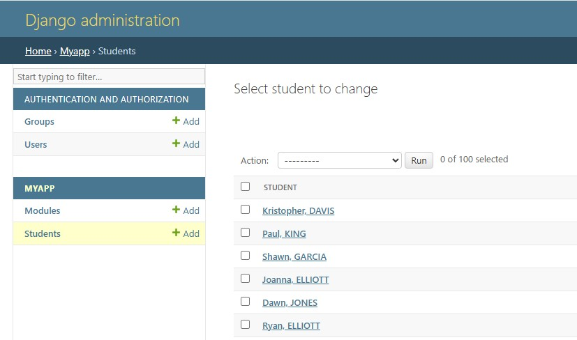
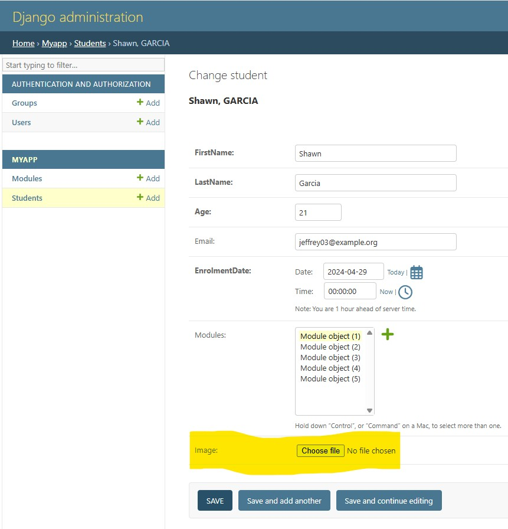

# Week 05 Django Statics, Bootstrap & Pagination

At the moment our web site consists of a home page with a long list of students and a page showing individual student details. Along with an admin site enabling us to edit the backend database. All of this is not very user friendly and is not responsive.

## Adding Dynamic Images

It would be good to be able to upload images of our students to the database for things like ID cards etc.

Firstly we should add a string representation of our student class so that when looking at the admin pages we are not confronted with things such as ```student object (1976)```. We do this by creating a ```__str__``` method in the ```Student``` class - for those that are familar with Java this is similar to the ```toString``` method.

```python
def __str__(self):
    return self.firstName.capitalize() + ", " + self.lastName.upper()
```

When you redisplay the student list on the admin page this method will be used to display the data:



For completeness you should also add a similar method to the Module class.

To enable an image to be uploaded for each student you must add an image attribute to the Student model:

```python
image = models.ImageField(upload_to='images/', blank = True)
```

Only a path to the image file will be stored in the database, the files will be uploaded to to an images folder that will be created automatically for you. Note because we already have a database that is populated with data it is important that we use the ```blank=True``` argument here so that we can use default nulls for the existing entries. Once you add the attribute if your server is running you will see the following error:

```bash
myApp.Student.image: (fields.E210) Cannot use ImageField because Pillow is not installed.
        HINT: Get Pillow at https://pypi.org/project/Pillow/ or run command "python -m pip install Pillow".
```

So you will need to install Pillow and update your requirements file. [Pillow](https://pillow.readthedocs.io/en/stable/) is the friendly PIL fork by Alex Clark and Contributors. PIL is the Python Imaging Library by Fredrik Lundh and Contributors. As you have modified your student model you will need to make and apply new migrations:

```python
python manage.py makemigrations
python manage.py migrate
```

Selecting a student within the admin site will then show an image attribute and an option to browse to a file to upload:



### Using dynamic images in a template

Dynamic image files are considered media files by Django and we need to configure our project to use them.

1. Edit the ```settings.py``` file to ensure the media url and root is set.

    ```python
    MEDIA_URL = '/media/'
    MEDIA_ROOT = BASE_DIR
    ```

2. Edit the project ```urls.py``` file to add a pattern for the media data:

    ```python
    from django.conf import settings
    from django.conf.urls.static import static

    urlpatterns += static(settings.MEDIA_URL, document_root = settings.MEDIA_ROOT)
    ```

3. You can now use the image url in your ```student_details.html``` template:

    ```html
    <!-- Note checking if image exists first -->
    
        </img>
    
    ```

## Static Files

Any website will require several static files as opposed to the dynamic ones we have already considered. These could be logos, general images or framework files. Django has a mechanism for handling static content as apposed to the dynamic content loaded from the database. Each app has it’s own static directory into which static files are saved. The project has it’s own static directory into which ALL static content is loaded. A python management script is used to perform this task. See the [Django documentation](https://docs.djangoproject.com/en/6.0/howto/static-files/) for further details.

### Procedure

1. Ensure that ```django.contrib.staticfiles``` is included in your INSTALLED_APPS section of ```settings.py```.

2. The settings file should also define  STATIC_URL e.g.

    ```python
    STATIC_URL = "static/“
    ```

3. Also define the static root in the ```settings.py``` - this is the directory that the collect statics command will store all the static files:

    ```python
    STATIC_ROOT = BASE_DIR / "staticfiles“
    ```

4. Each app should have a directory called ‘static’ in which you store the static files for that app e.g. ```myApp/static/myApp/file1.jpg```

5. You can also set static files in other directories that are not tied to a specific app by defining paths in the settings.py file e.g.

    ```python
    STATICFILES_DIRS = [
        BASE_DIR / “mystaticfiles",
        "/var/www/static/",
    ]
    ```

6. Then running ```python manage.py collectstatic``` will copy all files from your static folders into the STATIC_ROOT directory.

7. You can then use the static files in a template e.g.:

    ```html
    
    
    
    ```

## Bootstrap

Bootstrap is a popular frontend toolkit that enables developers to create responsive web sites very quickly

- Mobile first
- Plenty of pre-designed UI components ready to use
- Bootstrap theme and customization lets you easily change styles.
- It is free to use :-)

### Installing Bootstrap

There are two basic methods for using Bootstrap - the simplest is to use the precompiled CSS and JavaScript files via jsdeliver. See [bootstrap quick start](https://getbootstrap.com/docs/5.3/getting-started/introduction/#quick-start) for examples.

```html
<html lang="en">
  <head>
    <meta charset="utf-8">
    <meta name="viewport" content="width=device-width, initial-scale=1">
    <title>Bootstrap demo</title>
    <link href="https://cdn.jsdelivr.net/npm/bootstrap@5.3.8/dist/css/bootstrap.min.css" rel="stylesheet" integrity="sha384-sRIl4kxILFvY47J16cr9ZwB07vP4J8+LH7qKQnuqkuIAvNWLzeN8tE5YBujZqJLB" crossorigin="anonymous">
  </head>
  <body>
    <h1>Hello, world!</h1>
    <script src="https://cdn.jsdelivr.net/npm/bootstrap@5.3.8/dist/js/bootstrap.bundle.min.js" integrity="sha384-FKyoEForCGlyvwx9Hj09JcYn3nv7wiPVlz7YYwJrWVcXK/BmnVDxM+D2scQbITxI" crossorigin="anonymous"></script>
  </body>
</html>
```

OR

You can download the precompiled CSS and JavaScript files from [Bootstrap.com](https://getbootstrap.com/docs/5.3/getting-started/download/) then add the ```js``` and ```cs``` folders to your static files and load them up as you would normal static files e.g.:

```html

<!doctype html>
<html lang="en" data-bs-theme="auto">
<head>
    <meta charset="utf-8" />
    <meta name="viewport" content="width=device-width, initial-scale=1" />

    <!-- Normal header stuff -->
    <title>Nigel's University</title>

    <!-- Load bootstrap CSS -->
    <script src=""></script>
    <link href="" rel="stylesheet" />
</head>
<body>

     <!-- Load bootstrap JavaScipt, do this at the end of your body for faster loading -->
    <script src="" class="astro-vvvwv3sm"></script>
</body>
```

### Bootstrap Examples

There are a vast collection of example templates for you to use either view them or download the source [Bootstrap](https://getbootstrap.com/docs/5.3/examples/). Simply find examples you like and then mix and match the components to build your web site.

For the University Example I have used:

1. A simple [nav bar](https://getbootstrap.com/docs/5.3/components/navbar/)

    Raw code from bootstrap:

    ```html
    <nav class="navbar navbar-expand-lg bg-body-tertiary">
        <div class="container-fluid">
            <a class="navbar-brand" href="#">Navbar</a>
            <button class="navbar-toggler" type="button" data-bs-toggle="collapse" data-bs-target="#navbarNav" aria-controls="navbarNav" aria-expanded="false" aria-label="Toggle navigation">
            <span class="navbar-toggler-icon"></span>
            </button>
            <div class="collapse navbar-collapse" id="navbarNav">
            <ul class="navbar-nav">
                <li class="nav-item">
                <a class="nav-link active" aria-current="page" href="#">Home</a>
                </li>
                <li class="nav-item">
                <a class="nav-link" href="#">Features</a>
                </li>
                <li class="nav-item">
                <a class="nav-link" href="#">Pricing</a>
                </li>
                <li class="nav-item">
                <a class="nav-link disabled" aria-disabled="true">Disabled</a>
                </li>
            </ul>
            </div>
        </div>
    </nav>
    ```

    We just need to place this code in ```base.html``` and modify the menu item names and use appropriate links. I am going to have the home page with just the hero element and then have two other pages one with a list of students and the other with a list of modules.

    Modified ```home.html``` template

    ```html
    
    <!doctype html>
    <html lang="en" data-bs-theme="auto">
    <head>
        <meta charset="utf-8" />
        <meta name="viewport" content="width=device-width, initial-scale=1" />

        <!-- Normal header stuff -->
        <title>Nigel's University</title>

        <!-- Load bootstrap css -->
        <link href="" rel="stylesheet" />
    </head>
    <body>

        <nav class="navbar navbar-expand-lg bg-body-tertiary">
            <div class="container-fluid">
                <a class="navbar-brand" href="#">My University</a>
                <button class="navbar-toggler" type="button" data-bs-toggle="collapse" data-bs-target="#navbarNav" aria-controls="navbarNav" aria-expanded="false" aria-label="Toggle navigation">
                <span class="navbar-toggler-icon"></span>
                </button>
                <div class="collapse navbar-collapse" id="navbarNav">
                <ul class="navbar-nav">
                    <li class="nav-item">
                    <a class="nav-link active" aria-current="page" href="">Home</a>
                    </li>
                    <li class="nav-item">
                    <a class="nav-link" href="#">Students</a>
                    </li>
                    <li class="nav-item">
                    <a class="nav-link" href="#">Modules</a>
                    </li>
                </ul>
                </div>
            </div>
        </nav>
    
        
        

        <footer>My footer from base.html</footer>

        <!-- Load bootstrap JavaScipt, do this at the end of your body for faster loading -->
        <script src="" class="astro-vvvwv3sm"></script>
    </body>
    </html>
    ```

    Note - I have used a slightly different notation in the home url here. In ```myApp/urls.py``` I have added the line ```app_name = "myApp"``` then removed the myApp prefix. Meaning I can use the url syntax above giving the app name and name of the path.

    ```python
    from django.urls import path

    from . import views 

    app_name = "myApp"

    urlpatterns = [
        path("", views.home, name="home"),
        path('<int:student_id>/', views.student_detail, name='student_detail'),
    ]
    ```

    Also note I have not yet created paths or views to the Student and Modules links.

2. A [centered hero](https://getbootstrap.com/docs/5.3/examples/heroes/)

    Raw code from bootstrap:

    ```html
    <div class="px-4 py-5 my-5 text-center"> 
         
        <h1 class="display-5 fw-bold text-body-emphasis">Centered hero</h1> 
        <div class="col-lg-6 mx-auto"> 
            <p class="lead mb-4">Quickly design and customize responsive mobile-first sites with Bootstrap, the world’s most popular front-end open source toolkit, featuring Sass variables and mixins, responsive grid system, extensive prebuilt components, and powerful JavaScript plugins.</p> 
        
            <div class="d-grid gap-2 d-sm-flex justify-content-sm-center"> 
                <button type="button" class="btn btn-primary btn-lg px-4 gap-3">Primary button</button> 
                <button type="button" class="btn btn-outline-secondary btn-lg px-4">Secondary</button> 
            </div> 
        </div> 
    </div>
    ```

    Modified ```home.html```

    ```html
    
    
        

        <div class="px-4 py-5 my-5 text-center"> 
             
            <h1 class="display-5 fw-bold text-body-emphasis">Web Programming</h1> 
            <div class="col-lg-6 mx-auto"> 
                <p class="lead mb-4">A simple example application for the Web Programming Module.</p> 
            
                <div class="d-grid gap-2 d-sm-flex justify-content-sm-center"> 
                    <button type="button" class="btn btn-primary btn-lg px-4 gap-3 onclick="location.href=''">Students</button> 
                    <button type="button" class="btn btn-outline-secondary btn-lg px-4">Modules</button> 
                </div> 
            </div> 
        </div>
    
    ```

    Note - I have set the size of my image here - if you are using a different image you will need to experiment.  We will also have to add an onclick event to each of the buttons to the student and module list pages once complete e.g. ```onclick="location.href={% url 'myApp:studentlist'```.

3. A [table](https://getbootstrap.com/docs/5.3/content/tables/) with striped rows and hoverable rows

    Code from bootstrap:

    ```html
    <table class="table">
    <thead>
        <tr>
        <th scope="col">#</th>
        <th scope="col">First</th>
        <th scope="col">Last</th>
        <th scope="col">Handle</th>
        </tr>
    </thead>
    <tbody>
        <tr>
        <th scope="row">1</th>
        <td>Mark</td>
        <td>Otto</td>
        <td>@mdo</td>
        </tr>
        <tr>
        <th scope="row">2</th>
        <td>Jacob</td>
        <td>Thornton</td>
        <td>@fat</td>
        </tr>
        <tr>
        <th scope="row">3</th>
        <td>John</td>
        <td>Doe</td>
        <td>@social</td>
        </tr>
    </tbody>
    </table>
    ```

    New template file ```studentlist.html```

    ```html
    
    

    <h2>Students Enrolled</h2>
        <table class="table table-striped">
        <thead class="thead-dark">
            <tr>
            <th scope="col">ID</th>
            <th scope="col">First Name</th>
            <th scope="col">Last Name</th>
            </tr>
        </thead>
        <tbody>
            
            <tr>                  
                <th scope="row"><a href="">{{student.id}}</th>
                <td>{{student.firstName|capfirst}}</td>
                <td>{{student.lastName|upper}}</td>
            </tr>
            
        </tbody>
    </table>
    
    ```

To complete this you just need to:

1. Add a template for the module list
2. Create url paths to your new template files
3. Create views for these templates
4. Ensure all the links are correct in your navigation bar and homepage.

## Pagination

At the moment our application presents the user with a long list of 1000 students. This is not ideal; we would like to present the user with a reasonable size list of students that would fit on one page and then be able to scroll through these pages. Django provides a [Paginator class](https://docs.djangoproject.com/en/6.0/ref/paginator/#django.core.paginator.Paginator) and associated [Page class](https://docs.djangoproject.com/en/6.0/ref/paginator/#django.core.paginator.Page) for just this.

### Paginator Constructor

```python
Paginator( object_list, per_page, orphans=0, allow_empty_first_page=True, error_messages=None)
```

- Object list is typically your QuerySet.
- per_page is the number of objects to display on each page
- Orphans defaults to 0 – the number of objects which may be added to the last page, so they are not displayed on a separate page.
- Allow the fist page to be empty or not
- Override the default error message for an empty page.

### Paginator Important Methods

```python
Paginator.get_page(number)
```

- Note the page numbers here are 1 based
- Returns a Page object
- If the page isn’t a number, it returns the first page.
- If the page number is negative or greater than the number of pages, it returns the last page.
- Raises an EmptyPage exception only if you specify Paginator(..., allow_empty_first_page=False) and the object_list is empty.

```python
Paginator.get_elided_page_range(number, *,on_each_side=3, on_ends=2)
```

- Returns a 1-based list of page numbers similar to Paginator.page_range, but may add an ellipsis to either or both sides of the current page number when Paginator.num_pages is large.


*Image source : [Real Python](https://realpython.com/django-pagination/#implementing-pagination-url-parameters)*

## Implementing Pagination

1. Modify ```views.py``` so that our studentlist view creates a paginator object and passes the required page object through to our template.

    ```python
    def studentlist(request, page):
        students = Student.objects.all().order_by("lastName")
        paginator = Paginator(students, 20)
        page_object = paginator.get_page(page)
        page_object.adjusted_elided_pages = paginator.get_elided_page_range(page, on_each_side=1, on_ends=1)
        context = {"page_obj": page_object}

        return render(request,'studentlist.html', context)
    ```

    Note we have added a page argument to the function here so will have to modify all our references to this call.  For ease of finding specific students we have also ordered them by last name.

2. Modify ```myApp/urls.py``` to reflect the changes to the module parameter list.

    ```python
    from django.contrib import admin
    from django.urls import path

    from . import views

    app_name = "myApp"

    urlpatterns = [
        path('', views.home, name="home"),
        path('studentlist/<int:page>/', views.studentlist, name='studentlist'),
        path('<int:student_id>/', views.student_detail, name='student_detail'),   
    ]
    ```

    Note the line ```app_name = "myApp"``` here, this allows us to drop some of the prefixes in our patterns and just keeps things a bit cleaner.

3. Modify all the URL's that we had to the student list page in our templates.

    ```html
    
    ```

    This will load the first page of the student list.

4. Modify the ```base.html``` template to have a pagination block.

    ```html
        </nav>

        
        

        
        

        <footer><i>My footer from base.html</i></footer>

        <script src="" class="astro-vvvwv3sm"></script>
    </body>
    </html>
    ```

5. Place the pagination links into ```studentlist.html```

    ```html
    % extends "base.html" %}
    

    <h2>Students Enrolled</h2>
        <table class="table table-striped table-hover">
        <thead class="thead-dark">
            <tr>
            <th scope="col">ID</th>
            <th scope="col">First Name</th>
            <th scope="col">Last Name</th>
            </tr>
        </thead>
        <tbody>
            
            <tr>                  
                <th scope="row"><a href="">{{student.id}}</th>
                <td>{{student.firstName|capfirst}}</td>
                <td>{{student.lastName|upper}}</td>
            </tr>
            
        </tbody>
        </table>

    

    
    <nav aria-label="Page navigation">
        <ul class="pagination justify-content-center">
        
            <li class="page-item">
            <a class="page-link" href="" aria-label="Previous">
                <span aria-hidden="true">&laquo;</span>
            </a>
            </li>
        

        
            
            {{page_number}}
            
            
                <li class="page-item active"><a class="page-link" href="">{{page_number}}</a></li>
            
                <li class="page-item"><a class="page-link" href="">{{page_number}}</a></li>
                
            
        
        
        
            <li class="page-item">
            <a class="page-link" href="" aria-label="Previous">
                <span aria-hidden="true">&raquo;</span>
            </a>
            </li>
        
        </ul>
    </nav>

    <a>page {{page_obj.number}} of {{page_obj.paginator.num_pages}}</a>

    
    ```

[back](../README.md)