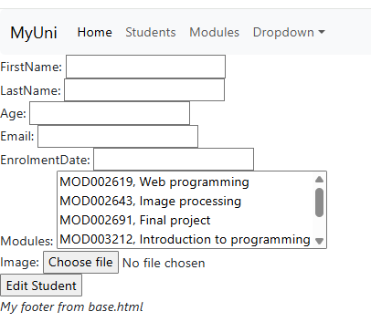
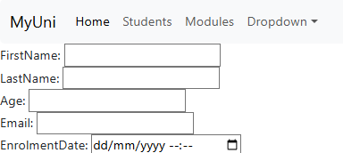
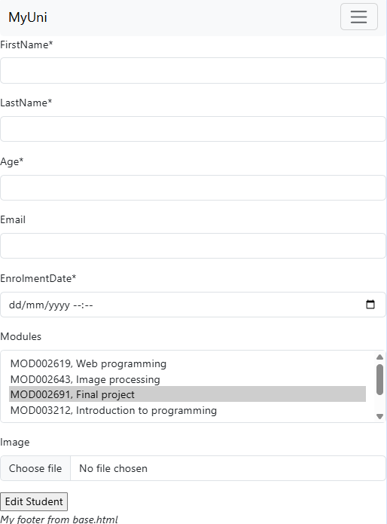
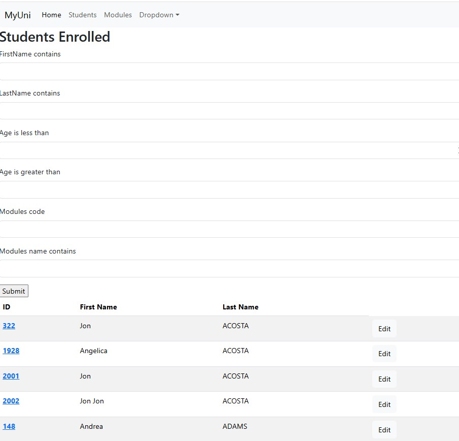
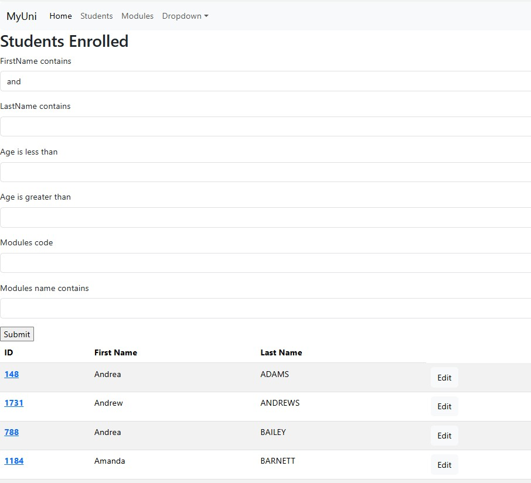
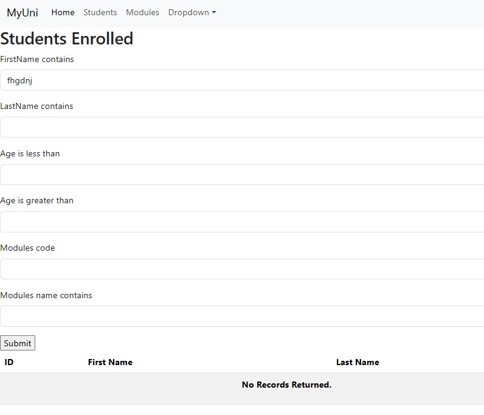

# Week 06 Django Forms

## HTML Forms

Forms are used to provide the user with interactive elements and controls - enabling the input and modification of data. Ky attribtes:

- name – Cannot be an empty string and must be unique amongst the form elements
- action – The URL that process the form data
 
See [Mozilla.org](https://developer.mozilla.org/en-US/docs/Web/HTML/Reference/Elements/form) for full details.

Within the ```<form>``` element we can define multiple input types, see [Mozilla.org](https://developer.mozilla.org/en-US/docs/Web/HTML/Reference/Elements/input) for a complete list of these.


### The Form Method Attribute 

This defines the HTTP method to submit the form with. The only allowed methods/values are (case insensitive):

- post: The POST method; form data sent as the request body.
- get (default): The GET; form data appended to the action URL with a ? separator. Use this method when the form has no side effects.
- dialog: When the form is inside a ```<dialog>```, closes the dialog and causes a submit event to be fired on submission, without submitting data or clearing the form.
- [Mozilla.org](https://developer.mozilla.org/en-US/docs/Web/HTML/Reference/Elements/form#method)

#### HTML POST v GET

We have been using GET requests as a matter of course in our current application – these can be seen in the terminal we run our server in:

```http
18/Jun/2026 12:52:38] "GET /student/543/ HTTP/1.1" 200 1734
```

As mentioned above if we use GET to pass data from a user input for the data will be appended to the URL in plain text for all to see.

- Clearly a security risk
  
  ```http
  https://example.com/login?username=alice&password=SuperSecret123
  ```

- Could also be visible in
  - Browser address bar, browser history, server logs, proxy logs …

With a HTML POST the data is not visible in the URL but encoded in the actual request.
See [mozilla.org](https://developer.mozilla.org/en-US/docs/Web/HTTP/Reference/Methods/POST) for more details.

As such when using forms always use POST to send data rather than GET. For high security applications it would be best to use HTTPS rather than plain HTTP. We have been using POST when entering our user name and password into the admin app:

```http
[18/Jun/2026 13:09:52] "GET /admin/ HTTP/1.1" 302 0
[18/Jun/2026 13:09:52] "GET /admin/login/?next=/admin/ HTTP/1.1" 200 4080
[18/Jun/2026 13:09:52] "GET /static/admin/css/login.css HTTP/1.1" 304 0
[18/Jun/2026 13:10:03] "POST /admin/login/?next=/admin/ HTTP/1.1" 302 0
[18/Jun/2026 13:10:03] "GET /admin/ HTTP/1.1" 200 8767
```

## Django Forms

Django has a form class:

- Looks a lot like a Model
- Describes a form and determines how it works and appears.
- A form’s fields are themselves classes; they manage form data and perform validation when a form is submitted.
- A form field is represented to a user in the browser as an HTML “widget”
- Can be bound to a Model
- See the [Django documentation](https://docs.djangoproject.com/en/6.0/topics/forms/) for more details.

### Typical view to handle POST data

```python
from django.http import HttpResponseRedirect
from django.shortcuts import render

from .forms import NameForm

def get_name(request):
    # if this is a POST request we need to process the form data
    if request.method == "POST":
        # create a form instance and populate it with data from the request:
        form = NameForm(request.POST)
        # check whether it's valid:
        if form.is_valid():
            # process the data in form.cleaned_data as required
            # ...
            # redirect to a new URL:
            return HttpResponseRedirect("/thanks/")
    # if a GET (or any other method) we'll create a blank form
    else:
        form = NameForm()

    return render(request, "name.html", {"form": form})
```

### Walkthrough for a Student

At the moment we have a simple student_detail.html template that just presents the data for an individual student. We be able to edit the data.

1. Add an edit option to the student list
2. Create a form class that is bound to our model for Student
3. Create a view to instantiate a form and pass it to our template
4. Create a template to display the form
5. Handle the return to be able to save the edits to the database


#### Edit option to the student list template

```student_list.html```

```html

   <tr>                  
      <th scope="row">
           <a href="">
          {{student.id}}
      </th>
      <td>{{student.firstName|capfirst}}</td>
      <td>{{student.lastName|upper}}</td>
      <td>
         <input class="btn btn-light" type="button" value="Edit"     
                onclick="location.href=''">
      </td>
   </tr>

```

#### Create a form class

```forms.py```

```python
from django import forms
from django.forms import fields 

from .models import Student, Module

class StudentEditForm(forms.ModelForm): 
    class Meta:
        model = Student
        fields = ['firstName', 
                  'lastName', 
                  'age',
                  'email',
                  'enrolmentDate',
                  'modules',
                  'image', ]
```

#### Create a view to instantiate a form

```views.py```

```python
from .forms import StudentEditForm

def student_edit(request, student_id):

    studentForm =  StudentEditForm()
    context={'studentForm':studentForm, 'student_id':student_id}

    return render(request, "student_edit.html", context )
```

#### Template to display the form

```sudent_edit.html```

```html


    

<form action="" method="POST" enctype="multipart/form-data" >
    
    
    {{ studentForm }}

    <input type="submit" value="Edit Student">
</form>


```

- The `csrf_token` is a cross site forgery token which is a security measure to stop man in the middle attacks see [OWASP](https://owasp.org/www-community/attacks/csrf) for details. Because codespaces maps ports to web addresses it can appear as an attempt at cross site forgery so we must add the following to our `settings.py` file.

    ```python
    CSRF_TRUSTED_ORIGINS = [
        "http://localhost:8000",
        "https://localhost:8000",
        "https://*.app.github.dev",
    ]
    ```

- *nb* You must include the ```enctype="multipart/form-data"``` attribute in the form otherwise our file upload will not work!

This results in the form as show below:



We can improve this by adding a date time picker widget. This requires adding the widget to the from's meta class:

```python
widgets = {
            "enrolmentDate": forms.DateTimeInput(attrs={"type":"datetime-local"})
          }
```

See the [Django documentation](https://docs.djangoproject.com/en/6.0/ref/forms/widgets/) for other widget options.



We can also add bootstrap styling by installing [Crispy Forms](https://django-crispy-forms.readthedocs.io/en/latest/).

##### Installing crispy forms

Fist add the python libary:

```bash
pip install django-crispy-forms crispy-bootstrap5
```

Modify ```setting.py``` to enable the crispy forms:

```python
INSTALLED_APPS = [
    …
    "crispy_forms",
    "crispy_bootstrap5",
    …
]

…

CRISPY_ALLOWED_TEMPLATE_PACKS = "bootstrap5“
CRISPY_TEMPLATE_PACK = "bootstrap5"
```

Then load the crispy tags in your template:

```html
<form action="" method="POST" enctype="multipart/form-data">
    
    
    {{ studentForm|crispy }}
    <input type="submit" value="Edit Student">
</form>
```

Giving a better looking result - you can also modify the appearance by using different widget to override the defaults.



### Saving the data to the database

Modify the view:

```python
from django.shortcuts import get_object_or_404

def student_edit(request, student_id):
    student = get_object_or_404(Student, pk=student_id)
    print(f'Loaded student image: {student.image}')
    if request.method == "POST":
        # create a form instance and populate it with data from the request:
        form = StudentEditForm(request.POST, request.FILES, instance=student)
        # check whether it's valid:
        if form.is_valid():
            form.save()
            # Redirect to student details page showing edits
            return redirect("myApp:student_detail", student_id=student_id )
    else:
        studentForm =  StudentEditForm(instance=student)
    context={'studentForm':studentForm, 'student_id':student_id}
    return render(request, "student_edit.html", context )
```

This code loads the current student from the database and populates the form with the object instance data if it is a GET, then sends that form to the template for rendering. 

On a POST the form is created with the posted data - it is important to note that we have included ```request.FILES``` as an argument here to ensure that uploading an image file work correctly, the ```instance=student``` ensures that the current student will be updated omitting this will create a new record in the database. The form data is then checked for validity and then saved to the database.

## Filtering Data In Our List View

At the moment we have a list of students covering 100 pages so finding a single student is difficult or say all the the students enrolled on Web Programming.  Django provides a [Filter class](https://django-filter.readthedocs.io/en/stable/) to enable us to achieve this easily. The implementation of these filters is very similar to that of the forms we have just looked at.

1. Install Django filters
2. Update the setting to enable us to use them
3. Create a filter class which is tied to your model
4. Filter your selection in your view
5. Provide the user with an input form to enter filtering details in your template.

### Install Django filters

```bash
pip install django-filter
```

### Update the setting to enable us to use filters

```settings.py```

```python
NSTALLED_APPS = [
    ...
    "django_filters",
    ...
]
```

### Create a filter class

Create a new file ```myApp/filters.py```

```python
import django_filters

from .models import Student

class StudentFilter(django_filters.FilterSet):
 
    class Meta:
        model = Student
        fields = {'firstName' :['icontains'], 
                  'lastName' : ['icontains'], 
                  'age' : ['lt', 'gt'],
                  'modules__code' : ['exact'],
                  'modules__name' : ['icontains']
        }
```

This will create a filter using the Student class as it's model, the fields attribute in the contained Meta class is a dictionary of attribute names and filter types. The filter types is a list of type names as defined in the [Django documentation](https://docs.djangoproject.com/en/dev/ref/models/querysets/#id4). The double underscore syntax shown here ```modules__code``` enables us to follow down the relationship fields to the underlying model so this is referencing the module.code attribute.

### Filter the selection in the view

```views.py```

```python
def studentlist(request, page):
    students = Student.objects.all().order_by("lastName")
    filter = StudentFilter(request.GET, queryset=students)

    paginator = Paginator(filter.qs, 20)
    page_obj = paginator.get_page(page)
    page_obj.adjusted_elided_pages = paginator.get_elided_page_range(page, on_each_side=1, on_ends=1)

    context = {"page_obj": page_object, "filter":filter}

    return render(request,'studentlist.html', context)
```

This only actually has three edits from our previous version:

1. Create the filter ```filter = StudentFilter(request.GET, queryset=students)``` using the GET from our request and the student list.
2. We then use the filter query set to instantiate our paginator ```paginator = Paginator(filter.qs, 20)```
3. Then add the filter to the context to pass through to our template ```context = {"page_obj": page_object, "filter":filter}```

### Provide the user with an input form to enter filtering details

```studentlist.html```

```html
...
    <form method="get">
        
        {{ filter.form | crispy }}
        <input type="submit" />
    </form>
    
    <table class="table table-striped table-hover">
      ...
```

This will provide the user with a simple form they can add data to filter on:



Entering data into the form and pressing submit will present the user with suitablely filter data - here we have found all the students whoose first name contains "and" :



However, pressing the next button looses the filtering options and we are presnted with our full list again.  Looking at the output in the terminal points us to the issue here:

```bash
[25/Jun/2026 12:17:23] "GET /studentlist/1/ HTTP/1.1" 200 11302
[25/Jun/2026 12:19:38] "GET /studentlist/1/?firstName__icontains=and&lastName__icontains=&age__lt=&age__gt=&modules__code=&modules__name__icontains= HTTP/1.1" 200 11814
[25/Jun/2026 12:24:36] "GET /studentlist/2/ HTTP/1.1" 200 11665
```

The first GET here is from our student button on the homepage, the second GET is from the submit from the filter form and contains the data the user entered ```firstName__icontains=and```, the final get is from the next button in our paginator block.  We need to preserve the GET arguments. To do this we need to pass the query string from our view through to our template:

```python
    querydict = request.GET.copy()
    
    context = {
        "filter": filter,
        "page_obj": page_obj,
        "query_string": urlencode(querydict),
    }
```

Then modify all our link references to pass on this query string in our template:

```html
href="?{{ query_string }}"
```

Resulting in a GET string similar to:

```bash
[25/Jun/2026 12:35:27] "GET /studentlist/2/?firstName__icontains=and&lastName__icontains=&age__lt=&age__gt=&modules__code=&modules__name__icontains= HTTP/1.1" 200 12751
```

If the user enters some data that returns no records at the moment we will get an error page, so we need to handle this so code similar to this in the template:

```html

      <table class="table table-striped table-hover">
        <thead class="thead-dark">
            <tr>
              <th scope="col">ID</th>
              <th scope="col">First Name</th>
              <th scope="col">Last Name</th>
            </tr>
        </thead>
        <tbody>
          <th scope="row" colspan=3><p class="text-center">No Records Returned.</p></th>
        </tbody>
      </table>
      <p class="text-center">No Records Returned.</p>

      <table class="table table-striped table-hover">
        ...

```

Will result in a reasonable output for the user:



We can also override the default labels for the form by creating a constructor for our filter:

```python

def __init__(self, *args, **kwargs):
    super().__init__(*args, **kwargs)

    self.form.fields["firstName__icontains"].label = "First Name"
    self.form.fields["lastName__icontains"].label = "Last Name"
    self.form.fields["modules__code"].label = "Module Code"
    self.form.fields["modules__name__icontains"].label = "Module Name"
```

You will need to know the names of the filters that have been created for you - if you add the line:

```python
print(f"Filter names: {StudentFilter().form.fields.keys()})
```

These will be printed for you in the console e.g.:

```bash
Filter names: dict_keys(['firstName__icontains', 'lastName__icontains', 'age__lt', 'age__gt', 'modules__code', 'modules__name__icontains'])
```

[back](../README.md)