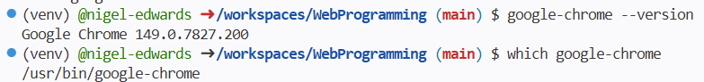

# Week 07 Django Test Driven Development

“Test-driven development” refers to a style of programming in which three activities are tightly interwoven: 
coding, testing (in the form of writing unit tests) design (in the form of refactoring).

It can be succinctly described by the following set of rules:

1. write a “single” unit test describing an aspect of the program
2. run the test, which should fail because the program lacks that feature
3. write “just enough” code, the simplest possible, to make the test pass
4. “refactor” the code until it conforms to the simplicity criteria
5. repeat, “accumulating” unit tests over time

[Agile Alliance](https://agilealliance.org/glossary/tdd/)

## Functional Tests v Unit Tests

**Functional Tests** - things a user knows about, how they are going to use your web site.
e.g. A user can order a Pizza.

- Black box testing – we are not interested in ‘how’ something works just making sure that the inputs give the correct outputs.

**Unit Tests** - Much more technical, these are things often that a user would not know or care about.

- e.g. the function pizza_description() method correctly describes a specific Pizza.
- White box testing – We know the code structure and should test all the paths through the code.

## Selenium

Selenium is an open-source testing framework from [Sauce Labs](https://saucelabs.com/) that software development and QA teams use to run fast and repeatable tests across browsers and operating systems. 

We can use Selenium within testing scripts to open web pages, send commands to those pages and test the responses. We will setup Selenium for use within CodeSpaces, if you are using a different system this will vary somewhat.

### Install Google Chrome

```bash
wget https://dl.google.com/linux/direct/google-chrome-stable_current_amd64.deb 
sudo apt update
sudo apt install -y ./google-chrome-stable_current_amd64.deb 
```

Double check this has worked OK

```bash
google-chrome --headless --no-sandbox --disable-gpu --version
which google-chrome  
```



Your version may differ.

Then install Selenium and update your requirements.txt file

```bash
pip install selenium 
pip freeze > requirements.txt
```

### Selenium Test Code

```python
from selenium import webdriver
from selenium.webdriver.chrome.options import Options

options = Options()
options.binary_location = "/usr/bin/google-chrome"
options.add_argument("--headless=new")
options.add_argument("--no-sandbox")
options.add_argument("--disable-dev-shm-usage")
options.add_argument("--disable-gpu")

browser = webdriver.Chrome(options=options)

browser.get("https://example.com")
assert browser.page_source.find('Example Domain') != -1, "ERROR - page not found"

print("Selenium working as expected")

browser.quit()
```

This code creates a Selenium web driver using the options defined here these work well for Code Spaces installations - note the binary location is the same as returned by ```which google-chrome``` so if yours is different use that. We then perform a get on the web page [https:\\example.com](https:\\example.com) and look for the phrase *'Example Domain'* on it throwing an exception if this is not found. If you want to see what happens when the assert is thrown just change the phrase to something not on the page.

## Unit Testing in Django

Django’s unit tests use a Python standard library module: [unittest](https://docs.python.org/3/library/unittest.html#module-unittest). This is a class-based system where you define methods to step up tests and tear them down once complete. Methods defined to actually run the tests must begin with *"test_"*.

The tests are run using ```python mangage.py test```. This initiates a test discovery. Each app has a file called test.py in which you can add tests which will be run. But you can add additional files within the app directories with the name ```test*.py```, the discovery process will find these and execute the tests within them.

### Example Test Class
```python
from django.test import TestCase
from django.contrib.staticfiles.testing import StaticLiveServerTestCase
from selenium import webdriver
from selenium.webdriver.chrome.options import Options

class HomePageTest(StaticLiveServerTestCase):

    @classmethod
    def setUpClass(cls):
        super().setUpClass()
        options = Options()
        options.binary_location = "/usr/bin/google-chrome"
        options.add_argument("--headless=new")
        options.add_argument("--no-sandbox")
        options.add_argument("--disable-dev-shm-usage")
        cls.browser = webdriver.Chrome(options=options)

    @classmethod
    def tearDownClass(cls):
        cls.browser.quit()
        super().tearDownClass()

    def test_home_page_contains_welcome(self):
        self.browser.get(self.live_server_url)
        self.assertIn("Welcome", self.browser.page_source)
```

Note the class is a sub class of StaticLiveServerTestCase, this means that it launches a live Django server in the background on setup, and shuts it down on teardown. The set up method creates a chrome webdriver in the same manner as in our test class earlier and we can access the home page of this using ```self.live_server_url```. The test method ```test_home_page_contains_welcome``` just opens the home page and looks for the string *"Welcome"*.

### Example of running a test with a fail

```bash
(venv) @nigel-edwards ➜ /workspaces/WebProgramming/hashthat (main) $ python manage.py test
Found 2 test(s).
Creating test database for alias 'default'...
System check identified no issues (0 silenced).
F.
======================================================================
FAIL: test_home_page_contains_fred (hashing.tests.HomePageTest.test_home_page_contains_fred)
----------------------------------------------------------------------
Traceback (most recent call last):
  File "/workspaces/WebProgramming/hashthat/hashing/tests.py", line 34, in test_home_page_contains_fred
    self.assertIn("Fred", self.browser.page_source)
AssertionError: 'Fred' not found in '<html><head></head><body><h1>Welcome</h1></body></html>'

----------------------------------------------------------------------
Ran 2 tests in 1.241s

FAILED (failures=1)
Destroying test database for alias 'default'...
```

## Testing Walkthrough

For this we will create a new project. This follows an example from [LinkedIn Learning](https://www.linkedin.com/learning/paths/become-a-django-developer) updated for current versions of Django etc.

### Expected Behaviour

- User enters some text into an input box with label “Enter text here:”
- User clicks submit button
- The SHA256 hash of the user’s input is displayed on a new page  
- Example Data:
  - User input: “hello”
  - SHA256 Hash: 2cf24dba5fb0a30e26e83b2ac5b9e29e1b161e5c1fa7425e73043362938b9824

You can use the [example web page](https://emn178.github.io/online-tools/sha256.html) to generate other hashes to generate hashes for other test phrases.

## Create the Project

```bash
django-admin startproject hashthat
```

So we know that we need a home page that displays the thext *"Enter text here:"* so write a test that looks for that:

```python
from django.test import TestCase
from django.contrib.staticfiles.testing import StaticLiveServerTestCase
from selenium import webdriver
from selenium.webdriver.chrome.options import Options

class HomePageTest(StaticLiveServerTestCase):

    @classmethod
    def setUpClass(cls):
        super().setUpClass()
        options = Options()
        options.binary_location = "/usr/bin/google-chrome"
        options.add_argument("--headless=new")
        options.add_argument("--no-sandbox")
        options.add_argument("--disable-dev-shm-usage")
        cls.browser = webdriver.Chrome(options=options)

    @classmethod
    def tearDownClass(cls):
        cls.browser.quit()
        super().tearDownClass()

    def test_home_page_exists(self):
        self.browser.get(self.live_server_url)
        self.assertIn("Enter text here:", self.browser.page_source)
```

**Run the test** we expect it to fail, then create enough code to pass the test:

1. Create an app:

   ```bash
   django-admin startapp hashing
   ```

2. Add the app to the settings file:

    ```python
    INSTALLED_APPS = [
        …
        "hashing",
    ]
    ```

3. Include our ```hashing\urls.py``` into the project ```urls.py```file

    ```python
    from django.contrib import admin
    from django.urls import include, path

    urlpatterns = [
        path("", include("hashing.urls")),
        path("admin/", admin.site.urls),
    ]
    ```

4. Add a URL path for home in ```hashing\urls.py```

    ```python
    from django.contrib import admin
    from django.urls import path
    
    from . import views
    app_name = "hashing"
    
    urlpatterns = [
        path('', views.home, name="home"),
    ]
    ```

5. Write a view to render the home page

    ```python
    from django.shortcuts import render
    def home(request):
        return render(request,  'home.html')
    ```

6. Create a template ```home.html```

    ```html
    Enter text here:
    ```

Now we can rerun the test and it should now pass. This clearly is not everything as we actually require:

- A form with a text box that we can enter data
- To be able to submit that data
- Some method to hash the data
- Then display the hash on a page

So need a test to handle that:

```python
from selenium.webdriver.common.by import By

    def test_hash_hello(self):
        # Fetch the home page 
        self.browser.get(self.live_server_url)

        # Get the text box so we can enter some data into it
        text = self.browser.find_element(By.ID,'id_text') 
        
        # enter the text 'hello' into that text box 
        text.send_keys('hello')

        # send a click event 
        self.browser.find_element(By.NAME, "submit").click()
        
        # check that the SHA256 of that string is output 
        self.assertIn('2cf24dba5fb0a30e26e83b2ac5b9e29e1b161e5c1fa7425e73043362938b9824’,self.browser.page_source)
```

As well as this functional tests we need some unit tests that check that:

- We can create a valid form
- Ensure our hash works as expected

```python
import hashlib
from .Forms import HashForm
class UnitTests(TestCase):

    def test_hash_form(self):
        form = HashForm(data={'text':'hello'}) 
        self.assertTrue(form.is_valid())

    def test_hash_function_works(self):
        text_hash = hashlib.sha256('hello'.encode(
                                            'utf-8')).hexdigest()
 
        self.assertEqual('2cf24dba5fb0a30e26e83b2ac5b9e29e1b161e5c1fa7425e73043362938b9824', text_hash)
```

Note because we do not need to actually runup a webserver instance for these we have placed these in a separate class and there is no need for the setup and tear down methods here and the class inherits from ```TestCase```. The test case ```test_hash_function_works``` should just work here as we have included the code we will use to hash our data,

### Create code to pass these tests

1. Create a form in ```hashing/forms.py```

    ```python
    from django import forms
    from django.forms.widgets import Textarea

    class HashForm(forms.Form):
        text = forms.CharField(label='Enter hash here:’, widget=Textarea)
    ```

2. Update the view to create this form and pass it to the template

    ```python
    from django.shortcuts import render
    from .forms import HashForm
    
    def home(request):
        form = HashForm()
        return render(request, 'hashing/home.html',{'form': form} )
    ```

3. Update the template to display the form

    ```html
    <form action="" method="post">
        
        {{ form.as_p }}
        <input name="submit" type="submit" value="Hash">
    </form>
    ```

4. Add trusted origins to `settings.py` - **nb** *this is for CodeSpaces only so our POSTs work*

    ```python
    CSRF_TRUSTED_ORIGINS = [
        "http://localhost:8000",
        "https://localhost:8000",
        "https://*.app.github.dev",
    ]
    ```

**The tests are still not passing** we could just add the hash of `hello`  to our template as plain text and then our tests would pass.  But that is not what we want, we need a database of hashes, so we can store these hashes and the plain text and display them as required. So we need unit tests for that functionality

- Store a hash of known text
- Retrieve it and make sure they are the same

```python
 def storeHashOfHello(self):
     # Create a hash of 'hello' 
     hashobj = Hash() 
     hashobj.text = 'hello' 
     hashobj.hash = '2cf24dba5fb0a30e26e83b2ac5b9e29e1b161e5c1fa7425e73043362938b9824'

     # Store in the database 
     hashobj.save()
     return hashobj

def test_hash_object(self):
    hashobj = self.storeHashOfHello()
    # Retrieve and check the text is correct 
    hashpulled = Hash.objects.get(hash='2cf24dba5fb0a30e26e83b2ac5b9e29e1b161e5c1fa7425e73043362938b9824')
    self.assertEqual(hashpulled.text, hashobj.text)
```

Note there is actually only one *test* here and one method to set the database up for that test.

We now need to write the code to pass these all these tests

1. Create a model for Hash in `hashing/models.py`

    ```python
    from django.db import models
    from django.forms.fields import CharField
    
    class Hash(models.Model): 
        text = models.TextField()
        # Note SHA256 give a 64bit hash
        hash = models.CharField(max_length=64)
    ```

2. Create and run migrations

    ```bash
    python manage.py makemigrations
    python manage.py migrate
    ```

3. Update our `settings.py` file so that our unit tests use a different database that our actual website

    ```python
    DATABASES = {
        "default": {
            "ENGINE": "django.db.backends.sqlite3",
            "NAME": BASE_DIR / "db.sqlite3",
            "TEST_NAME" : BASE_DIR / "test_db.sqlite3"
        }
    }
    ```

4. Create a URL path for our Hash page

    ```python
    urlpatterns = [
        path('', views.home, name="home"),
        path('hash/<str:hash>', views.hash, name='hash')
    ]
    ```

5. Create a view to pass the hash from the database to a template

    ```python
    from .models import Hash
    def hash(request, hash):
        # get the hash object from db
        hashobj = Hash.objects.get(hash=hash)
        # pass this object to a html file to use 
        return render(request, 'hash.html', {'hash': hashobj})
    ```

6. Create a template

    ```html
    <h2>Hash:</h2>
    <h2>{{ hash.hash }}</h2>
    <h2>Text:</h2>
    <p>{{ hash.text }}</p>
    <h3><a href="">Home</a></h3>
    ```

7. Handle the POST data in our home view

    ```python
    def home(request):
        if request.method == 'POST':
            filled_form = HashForm(request.POST)
            if filled_form.is_valid():
                clearText = filled_form.cleaned_data['text']
                hashText = hashlib.sha256(clearText.encode('utf- 8')).hexdigest()
                # See if we already have this 
                try:
                    hashPulled = Hash.objects.get(hash=hashText) 
                except Hash.DoesNotExist:
                    # Save it to the database 
                    newHash = Hash() 
                    newHash.text = clearText 
                    newHash.hash = hashText 
                    newHash.save()
                return redirect('hashing:hash', hash=hashText)
    
        form = HashForm()
        context = {'form': form }
        return render(request, 'home.html', context )
    ```

**All the tests should now pass**

```bash
(venv) @nigel-edwards ➜ /workspaces/WebProgramming/hashthatprojectdir (main) $ python manage.py test
Found 5 test(s).
Creating test database for alias 'default'...
System check identified no issues (0 silenced).
.....
----------------------------------------------------------------------
Ran 5 tests in 1.977s

OK
Destroying test database for alias 'default'...
```

### Testing invloving AJAX calls

It would be good to see the hash as you type data into the textbox.  To do this we would need to use an [Ajax](https://www.w3schools.com/xml/ajax_intro.asp), see [Mozilla's]() decription of this. So let us add a test for this:

```python
def test_hash_hello_ajax(self):

    # Fetch the home page 
    self.browser.get(self.live_server_url) 
       
    # Get the text box so we can enter some data into it
    text = self.browser.find_element(By.ID,'id_text') 
        
    # enter the text 'hello' into that text box 
    text.send_keys('hello')

    # enter the text 'hello' into that text box text.send_keys('hello')
    time.sleep(10)

    # check that the SHA256 of that string is output 
    self.assertIn('2cf24dba5fb0a30e26e83b2ac5b9e29e1b161e5c1fa7425e73043362938b9824', self.browser.page_source)
```

Because we are using Ajax we must wait after sending the keys as we are not certain how long the call will take. We have just used a very simple thread sleep here there are other [waiting strategies](https://www.selenium.dev/documentation/webdriver/waits/) - but this is the simplest although not guaranteed to work 100%.

So now add code to pass this test.

1. Add the Ajax call in `home.html`

    ```html
    <h2 id="quickhash"></h2>
    <script src="https://ajax.googleapis.com/ajax/libs/jquery/3.3.1/jquery.min.js"></script>
    
    <script>
        $('#id_text').keyup(function () { 
    
            var text = $(this).val();
    
            $.ajax({
                url: '/quickhash',
                data: { 'text': text    }, dataType: 'json',
                success: function (data) {
                    $('#quickhash').text(data['hash']);
                }
            });
        });
    </script>
    ```

2. Add a view to handle this

    ```python
    from django.http import JsonResponse
    
    def quickhash(request):
        text = request.GET['text'] 
        return JsonResponse({'hash':hashlib.sha256(text.encode ('utf-8')).hexdigest()})
    ```

3. Create a URL path for this view

    ```python
    urlpatterns = [
        path('', views.home, name="home"),
        path('hash/<str:hash>', views.hash, name='hash'),
        path('quickhash', views.quickhash, name='quickhash'),
    ]
    ```

All your tests should now pass and you have a useable working system.

### Issues with Ajax testing

One of the main issues we have is that the very nature of AJAX calls means that we cannot guarantee the order in which requests arrive. Our command `text.send_keys('hello')` will create a number of key up events and we can see this in action if we modify our view to print out the text that is received:

```python
def quickhash(request):
    text = request.GET['text'] 
    print(text)
    return JsonResponse({'hash':hashlib.sha256(text.encode ('utf-8')).hexdigest()})
```

This could generate output such as:

```bash
System check identified no issues (0 silenced).
...h
hel
he
hello
hell
.h
hel
he
hello
hell
..
```

Which means our test would fail as the hash would be of 'hell' not 'hello' as expected. We can resolve this by discarding older hashes in our Ajax code:

```html
<script>
    let latestRequest = 0;
    $('#id_text').keyup(function () { 

        // Increment the request counter for this new key press
        latestRequest++;
        var thisRequest = latestRequest;
        var text = $(this).val();

        $.ajax({
            url: '/quickhash',
            data: { 'text': text    }, dataType: 'json',
            success: function (data) {

                // Only update `#quickhash` if this is the latest keystroke
                if (thisRequest == latestRequest) {
                    $('#quickhash').text(data['hash']);
                }
            }
        });
    });
</script>
```

So only hashes of the latest text will be displayed. We could also modify our wait function to use:

```python
from selenium.webdriver.support.ui import WebDriverWait

# Wait for ajax
WebDriverWait(self.browser, 10).until(
    lambda driver: "2cf24dba5fb0a30e26e83b2ac5b9e29e1b161e5c1fa7425e73043362938b9824"
    in driver.page_source
)
```

 Rather than the simple thread sleep we used earlier - this will timeout if the condition is not met.

 [back](../README.md)